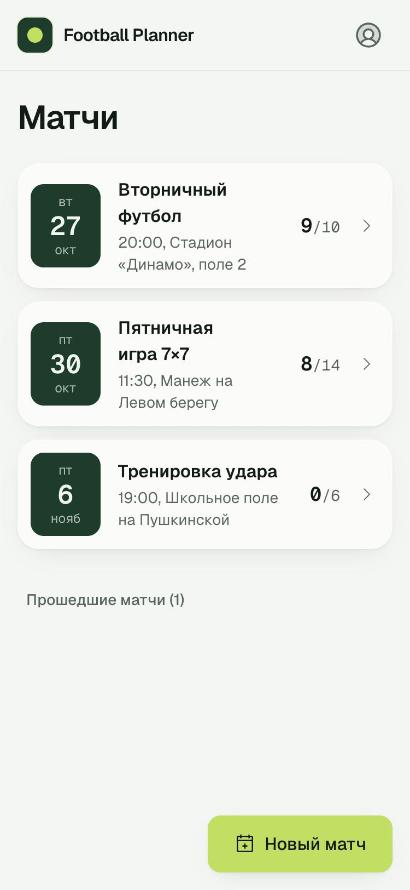
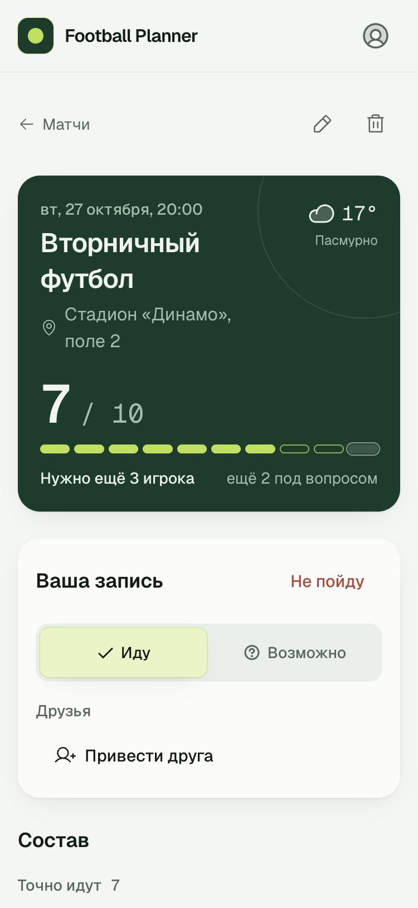
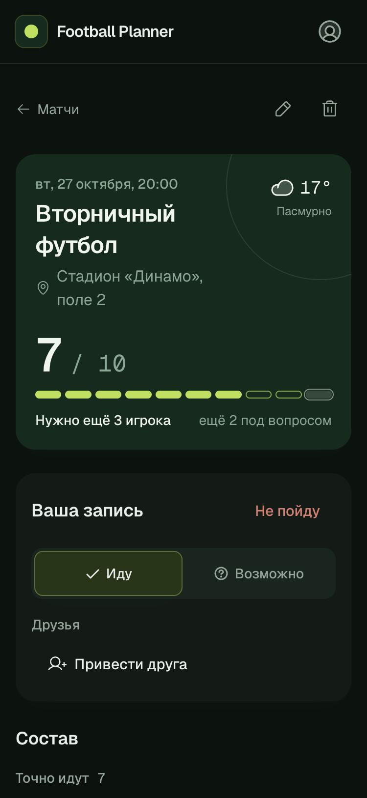
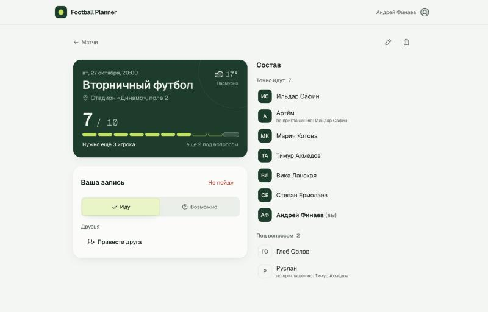

<div align="center">


# Football Planner

Sign-ups for amateur football matches: who is coming, how many are still missing, and what the weather will be.
The Telegram bot keeps a live, pinned announcement in your team chat.

</div>

<table>
  <tr>
    <td width="33%"></td>
    <td width="33%"></td>
    <td width="33%"></td>
  </tr>
  <tr>
    <td align="center">Upcoming matches</td>
    <td align="center">Match scoreboard</td>
    <td align="center">Dark theme</td>
  </tr>
</table>



## Features

- **One-tap sign-up.** "Иду" or "Возможно" right on the match page, change your mind later, bring friends and mark whether each of them is sure.
- **Match scoreboard.** Sure players against the minimum, maybe players shown separately, and how many are still missing.
- **Weather for the match day** from [Open-Meteo](https://open-meteo.com), no API key needed.
- **Telegram bot** with a pinned announcement per match that is edited on every change, quiet notes for sign-ups, and a loud message only when the minimum is reached, the time or place changes, or the match is cancelled.
- **Phone first**, with light and dark themes, keyboard navigation and screen reader labels.

### What the bot posts

```text
⚽ Вторничный футбол
📅 вт, 27 октября · 20:00
📍 Стадион «Динамо», поле 2

👥 7 из 10  ▰▰▰▰▰▰▰▱▱▱
✅ Точно: Ильдар Сафин, Артём (от Ильдар Сафин), Мария Котова, …
🤔 Возможно: Глеб Орлов, Руслан (от Тимур Ахмедов)
Нужно ещё 3                                    [ Записаться ]
```

## Stack

| Part                             | Technology                                                                                                                 |
| -------------------------------- | -------------------------------------------------------------------------------------------------------------------------- |
| Web app (`apps/web`)             | React 19, React Router 8, TanStack Query 5, Tailwind CSS 4, Motion, Vite 8                                                 |
| API (`apps/server`)              | Fastify 5, TypeBox, Mongoose 9, pino                                                                                       |
| Shared types (`packages/shared`) | TypeBox schemas used by the API and the app                                                                                |
| Telegram                         | [`@dirai/tg-kit`](https://www.npmjs.com/package/@dirai/tg-kit) on grammY ([source](https://github.com/DiRaiks/tg-bot-kit)) |
| Tests                            | Vitest, Testing Library, in-memory MongoDB                                                                                 |

## Getting started

Requires Node.js 24+ and npm 11.21+ (older npm versions produce a lockfile that `npm ci` rejects), plus MongoDB.

```bash
npm install
cp .env.example .env    # set MONGO_URI and JWT_SECRET
npm run dev             # API on http://localhost:3000, reloads on changes
npm run dev:web         # app on http://localhost:5173
```

A local MongoDB is one command away: `docker run --rm -p 27017:27017 mongo:8`.

The app calls the API under `/v1` on the same origin. Vite proxies it in development; in production the reverse proxy routes `/v1` to the server. Set `VITE_API_URL` to use another origin.

## Configuration

Copy `.env.example` to `.env`.

| Variable                                                           | Required | Description                                                                                                |
| ------------------------------------------------------------------ | -------- | ---------------------------------------------------------------------------------------------------------- |
| `MONGO_URI`                                                        | yes      | Any MongoDB connection string: Atlas (`mongodb+srv://…`) or self-hosted (`mongodb://mongo:27017/football`) |
| `JWT_SECRET`                                                       | yes      | At least 32 characters, e.g. `openssl rand -base64 48`                                                     |
| `PORT`                                                             |          | API port, `3000` by default                                                                                |
| `BOT_TOKEN`                                                        |          | Telegram bot token; notifications are off without it                                                       |
| `BOT_MODE`                                                         |          | `polling` (development) or `webhook` (production)                                                          |
| `BOT_WEBHOOK_URL`, `BOT_WEBHOOK_SECRET`                            |          | Public HTTPS URL of the API and a random secret, for webhook mode                                          |
| `TELEGRAM_ADMIN_IDS`                                               |          | Telegram user ids allowed to run admin bot commands                                                        |
| `PUBLIC_URL`                                                       |          | Site URL for links in bot messages                                                                         |
| `CORS_ORIGINS`                                                     |          | Allowed origins if the app is served from another origin                                                   |
| `TRUST_PROXY`                                                      |          | Proxy hops (usually `1`) or proxy IPs when running behind a reverse proxy                                  |
| `WEATHER_DEFAULT_LAT`, `WEATHER_DEFAULT_LON`                       |          | Weather location for matches without coordinates                                                           |
| `JWT_EXPIRES_IN`, `AUTH_RATE_LIMIT_MAX`, `LOG_LEVEL`, `LOG_FORMAT` |          | Session length, login attempts per minute, logging                                                         |

### Admins

Admins can edit and delete any match and sign-up:

```bash
npm run set-role --workspace apps/server -- user@example.com admin
```

The script reads `MONGO_URI` from `.env` and signs the user out everywhere so the new role applies at once.

## Project layout

```text
apps/
  server/    Fastify API and Telegram bot
  web/       React app
packages/
  shared/    API schemas and types
docs/        screenshots
```

## Tests

```bash
npm test     # API, shared types and web app
npm run lint
npm run types
```

API tests start an in-memory MongoDB and drive the server through HTTP, including the Telegram bot against a fake Telegram API. Web tests render screens with Testing Library against a fake API.

## License

[MIT](LICENSE)
